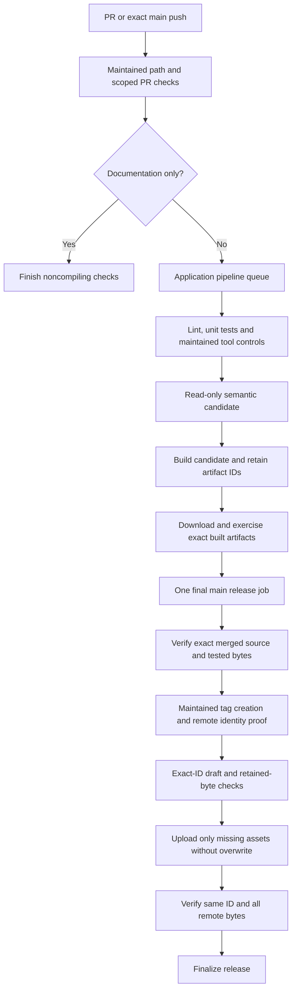

# CI/CD workflow

PRs cannot enter the final release job. Documentation never enters the application
queue. Canonical main pushes require a single first-parent commit; ambiguous
batches/initial history refuse instead of erasing an application edit/revert.
Queue order is arrival order, not guaranteed dispatch chronology; conflicting
candidates refuse rather than retargeting a tag. Squash merges qualify.

An earlier failed source remains untagged unless its own gates pass. Actions
Re-run failed jobs retains successful build outputs for partial-draft recovery;
a later application merge does not backfill failed commits. Published bytes are
verified, never overwritten. See [release tools and limits](../release/README.md)
for exact maintained sources, evidence, retry policy and remaining qualifications.
